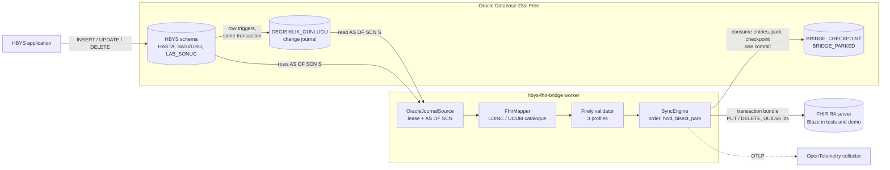
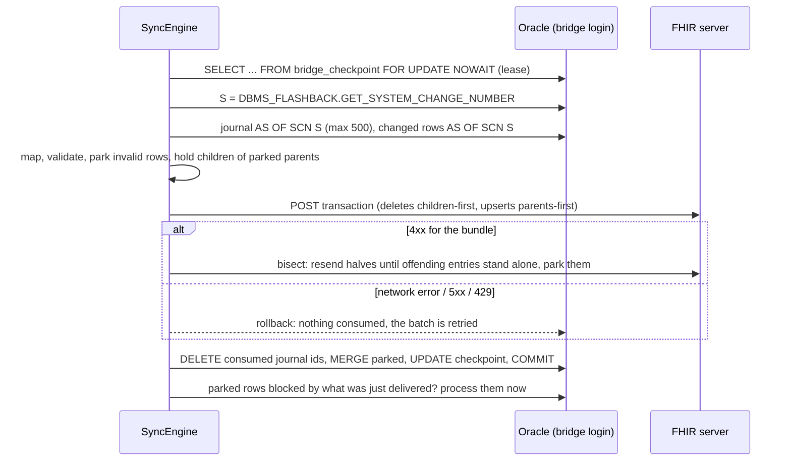

# hbys-fhir-bridge

[](https://github.com/hekimcan206/hbys-fhir-bridge/actions/workflows/ci.yml)
[](https://github.com/hekimcan206/hbys-fhir-bridge/actions/workflows/codeql.yml)


[](LICENSE)

Moves a relational hospital database to HL7 FHIR R4, incrementally and without losing a change. A synthetic HBYS
(Hastane Bilgi Yönetim Sistemi, Turkish hospital information system) schema on Oracle is mapped to `Patient`,
`Encounter` and `Observation`, validated locally with the Firely SDK against project profiles, and delivered to a FHIR
server as idempotent transaction bundles. Change capture is a trigger journal read at one Oracle SCN, so long
transactions and deletes cannot slip through, which the common "last updated" polling demonstrably lets happen.

> All data is synthetic; no real personal or health data. Names come from the Bogus `tr` locale, national ids are
> random digits with a valid checksum, and the schema is a generic HBYS shape, not any vendor's.

## Problem

Hospitals in Turkey run large relational HBYS databases, and more and more consumers want FHIR: national exchanges,
research platforms, patient apps. The usual bridge is a nightly or minutely job with
`WHERE guncelleme_zamani > :last_run`. It looks fine in a demo and fails in three ways on a live hospital:

1. **Lost changes.** A row is stamped when the statement runs but becomes visible when the transaction commits. If a
   later-stamped transaction commits first and the poller moves its watermark past it, the earlier one is skipped
   forever. Deletes leave nothing to poll at all.
2. **Wrong data that looks right.** Local test codes without LOINC, `mg/dl` vs `mmol/L`, a finished visit with no end,
   a death recorded before birth. The FHIR server accepts much of it (Blaze 1.12 even accepted `gender: "bogus"`).
3. **One bad row blocks everything, or retries create duplicates.** A rejected transaction stops the feed; a POST
   retried after a timeout creates a second copy.

## Solution

| Concern | How |
|---|---|
| Capture every change | Row triggers write `DEGISIKLIK_GUNLUGU` (change journal) in the same transaction as the change. Each batch reads the journal **and** the changed rows `AS OF` one SCN and deletes exactly the entries it delivered, in one commit. No watermark, nothing to skip ([ADR 0002](docs/adr/0002-change-capture-trigger-journal-read-as-of-one-scn.md)) |
| Correct FHIR | Pure, deterministic mapper; local codes to LOINC/UCUM through a catalogue that recognises unit spellings and never converts; Firely validator with three profiles and FHIRPath invariants ([ADR 0001](docs/adr/0001-relational-to-fhir-mapping-and-local-validation.md)) |
| Safe retries | `PUT [type]/[id]` / `DELETE` only, with UUIDv5 ids from `TABLE:primary key`, in transaction bundles. Re-sending anything is a no-op on the server ([ADR 0003](docs/adr/0003-idempotent-transaction-bundles-parking-and-bisection.md)) |
| Bad rows never block | Undeliverable rows are parked with a reason; children of a parked parent are held back and released in the same run once the parent is fixed; server rejections are isolated by bisection |
| One writer | The checkpoint row is locked `FOR UPDATE NOWAIT` for the length of a batch; a second instance backs off |
| Least privilege | The bridge login can read clinical tables (`SELECT, FLASHBACK`) and delete journal entries, nothing else; integration-tested |
| Operability | `/status` (backlog, oldest pending change, parked rows by reason), `/health/ready`, JSON logs, OpenTelemetry traces and metrics |

## Architecture



One batch, in order:



## Why this design

- **Journal + flashback instead of a watermark.** Every watermark (timestamp, sequence, even `ORA_ROWSCN`, which
  Oracle documents as a conservative upper bound) can be overtaken by a transaction that commits late. Reading the
  journal and the rows at the same SCN and deleting what was delivered has no such edge: an entry committed after S is
  simply still there next time. Log-based CDC (LogMiner, GoldenGate) would avoid the triggers but needs supplemental
  logging and privileges a bridge should not ask a hospital DBA for; the trigger cost is measured below.
- **Idempotent entries instead of exactly-once machinery.** The source side is at-least-once (a crash after the server
  accepted a bundle re-sends it). With deterministic ids and `PUT`, at-least-once is enough: replaying all 10,232
  rows wrote zero new versions on Blaze.
- **Validate before sending.** The server is not the gate (it accepted an invalid gender code). Local profiles also
  make data-quality problems visible as parked rows with a precise reason instead of silent garbage downstream.
- **Hold children of parked parents.** Discovering dependencies through 409s and bisection works, and stays as the
  fallback for server-side rejections, but at a 2% dirty rate it costs 42x more requests.
- **Recognise units, never convert.** A silent factor-18 glucose conversion error is worse than a parked row.

## Quick start

Requirements: Docker. (Development also needs the .NET 10 SDK.)

```bash
docker compose up --build
```

This starts Oracle Database 23ai Free (synthetic HBYS schema and the bridge login), Blaze, seeds 200 synthetic
patients with 2% deliberately broken rows, simulates 60 s of hospital writes, and runs the bridge.

```bash
curl -s localhost:18481/status          # backlog, oldest pending change, parked rows by reason
curl -s "localhost:18480/fhir/Observation?_summary=count"
docker compose run --rm --no-deps bridge verify --sample 300 --wait-seconds 120
```

`verify` waits until the journal is empty, then checks that the FHIR server holds exactly the rows that exist and are
not parked (count per type) and that a sample read back from the server is deep-equal to what the mapper produces from
the current row. Output of a local run (condensed):

```json
{
  "Consistent": true,
  "Counts": [
    { "ResourceType": "Patient", "Expected": 196, "OnServer": 196, "Matches": true },
    { "ResourceType": "Encounter", "Expected": 513, "OnServer": 513, "Matches": true },
    { "ResourceType": "Observation", "Expected": 1416, "OnServer": 1416, "Matches": true }
  ],
  "Parked": 102,
  "ParkedByReason": { "dependency": 60, "invalid": 13, "unknown-unit": 13, "unmapped-code": 16 },
  "Compared": 300,
  "Mismatches": []
}
```

and `/status` after the 60 s workload: `{"pendingChanges":0, "position":"scn:2297543", "batches":33, "parked":102, ...,
"totals":{"rows":2536, "delivered":2423, "bundlesSent":37}}`.

The CI `compose-demo` job runs exactly these steps on every push.

Development:

```bash
dotnet build
dotnet test --project tests/HbysFhirBridge.UnitTests          # 86 unit, property and golden tests, ~20 s
dotnet test --project tests/HbysFhirBridge.IntegrationTests   # 7 tests on Oracle + Blaze (Testcontainers), ~2 min
```

## Results (measured)

Intel i7-13620H, Docker Desktop VM with 7.6 GiB shared with other workloads, Oracle AI Database 26ai Free
(23.26.3, image `gvenzl/oracle-free:23-slim-faststart`), Blaze 1.12.0. Medians of 3 runs; method, raw runs and
caveats in [docs/benchmarks.md](docs/benchmarks.md).

| What | Result |
|---|---|
| Changes lost by the **journal** source, 4 concurrent writers holding transactions 0 / 0–50 / 0–200 ms (9 runs, 59,452 row changes) | **0 stale, 0 missing, 0 undeleted** in every run |
| Same workload, **timestamp watermark** baseline (medians) | 0 / 23 / 21 stale, 0 / 43 / 34 missing, 1,378 / 320 / 107 deletes never propagated |
| Initial load, 10,232 rows (2% dirty) into Blaze | **18.9 s, 541 rows/s**, 41 bundles; 9,638 delivered, 594 parked |
| Same load without holding children of parked parents | 38.1 s, 269 rows/s, 1,721 bundles (42x the requests) |
| Replay of every row (crash recovery at full scale) | 13.5 s, **0 new versions** on the server (all 6 runs) |
| Live sync, 20 writes/s, 500 ms poll | change-to-acknowledged lag p50 **0.45 s**, p95 0.56 s |
| Capture trigger cost, set-based 100k-row insert | 1.78 s → 5.94 s (about 41 µs extra per row) |
| Map / validate one Observation (BenchmarkDotNet) | 2.1 µs / 1.05 ms |

## Source schema

| Table | Meaning | FHIR | Notes |
|---|---|---|---|
| `HASTA` | patient | `Patient` | `DOSYA_NO` hospital file number (MRN), `TC_KIMLIK_NO` national id (exported only if enabled), `CINSIYET` E/K/B = male/female/unknown |
| `BASVURU` | visit / admission | `Encounter` | `BASVURU_TIPI` A/Y/C = outpatient/inpatient/emergency → `AMB`/`IMP`/`EMER`; `DURUM` → status |
| `LAB_SONUC` | laboratory result | `Observation` | `TETKIK_KODU` local test code → LOINC; `BIRIM` unit → UCUM; `REF_ALT/REF_UST` → reference range and H/L/N interpretation; `DURUM` ON/KESIN/DUZELTILDI → preliminary/final/corrected |
| `DEGISIKLIK_GUNLUGU` | change journal | - | `(TABLO_ADI, KAYIT_ID, ISLEM)` written by triggers |
| `BRIDGE_CHECKPOINT`, `BRIDGE_PARKED` | bridge state | - | owned by the bridge login |

**Identifier systems.** `https://hbys.example.org/fhir/...` URIs (identifier systems, local code systems, profiles)
are placeholders for the hospital's own namespace. A deployment replaces them, and the national id system with the URI
its national exchange mandates.

## Project layout

```
src/HbysFhirBridge.Core        mapping, LOINC/UCUM catalogue, profiles + validator, bundle builder, sync engine
src/HbysFhirBridge.Oracle      schema scripts, installer, journal source, parking/checkpoint, seeder, workload, timestamp baseline
src/HbysFhirBridge.Fhir        HTTP transaction sink, read client, in-memory sink for experiments
src/HbysFhirBridge.Synthetic   synthetic hospital generator (Bogus tr), TC Kimlik checksum
src/HbysFhirBridge.Worker      the process: sync loop, /status, health, telemetry; install/seed/workload/verify verbs
tests/                         unit + FsCheck + golden; Oracle + Blaze integration (Testcontainers)
benchmarks/                    BenchmarkDotNet micro benchmarks; capture and e2e experiments
```

## Limitations and next steps

- **Write-path cost.** Triggers add about 41 µs per row on a set-based insert here (3x for bulk loads). A real HBYS
  needs this measured on its workload; log-based capture (LogMiner/GoldenGate) is the alternative when it is too much.
- **Held children are conservative.** A lab result waits while its patient is parked, even if an older valid version
  of that patient is already on the server. That is deliberate (a result never overtakes a broken patient record), and
  visible in `/status`, but some deployments may prefer to send it.
- **Three resource types.** No `Practitioner`, `Organization`, `Condition`/ICD-10, `MedicationRequest` or
  `DiagnosticReport` grouping yet. The engine is type-agnostic; each type needs a mapper, profile and golden cases.
- **Terminology.** LOINC codes come from a curated catalogue of 12 tests and an invariant; there is no terminology
  server and no validation that a LOINC code exists. A real deployment needs a governed ConceptMap and a terminology
  service.
- **No national profiles.** The profiles are project profiles, not a Turkish national implementation guide or IPS.
- **Single consumer per pipeline.** Throughput scales with batch and bundle size, not with instances. Validation
  (~1 ms per resource) caps one process at roughly 1,000 resources/s on this CPU before I/O.
- **Security of the transport.** The demo uses plain HTTP inside the Docker network. Production needs HTTPS and an
  authenticated client (for example SMART Backend Services) — see the [threat model](docs/threat-model.md).
- **Measured on a shared laptop.** Absolute throughput varied 2x between identical runs; see the benchmark caveats.

## KVKK and privacy

KVKK (Kişisel Verilerin Korunması Kanunu, Law No. 6698) treats health data as a special category. The bridge follows
data minimisation: the national identity number is not exported unless `Bridge:IncludeNationalId=true`; logs carry
keys and reasons, not clinical values; the journal stores only table names and ids and is emptied as it is consumed.
See [docs/threat-model.md](docs/threat-model.md). Again: every record in this repository is synthetic.

## Documentation

- [ADR 0001: mapping and local validation](docs/adr/0001-relational-to-fhir-mapping-and-local-validation.md)
- [ADR 0002: change capture with a trigger journal read AS OF one SCN](docs/adr/0002-change-capture-trigger-journal-read-as-of-one-scn.md)
- [ADR 0003: idempotent transaction bundles, parking and bisection](docs/adr/0003-idempotent-transaction-bundles-parking-and-bisection.md)
- [ADR 0004: Blaze as the FHIR server for tests and demo](docs/adr/0004-blaze-as-the-fhir-server-for-tests-and-demo.md)
- [Benchmarks](docs/benchmarks.md) · [Threat model](docs/threat-model.md) · [Changelog](CHANGELOG.md) ·
  [Contributing](CONTRIBUTING.md) · [Security](SECURITY.md)

## License

[MIT](LICENSE)
